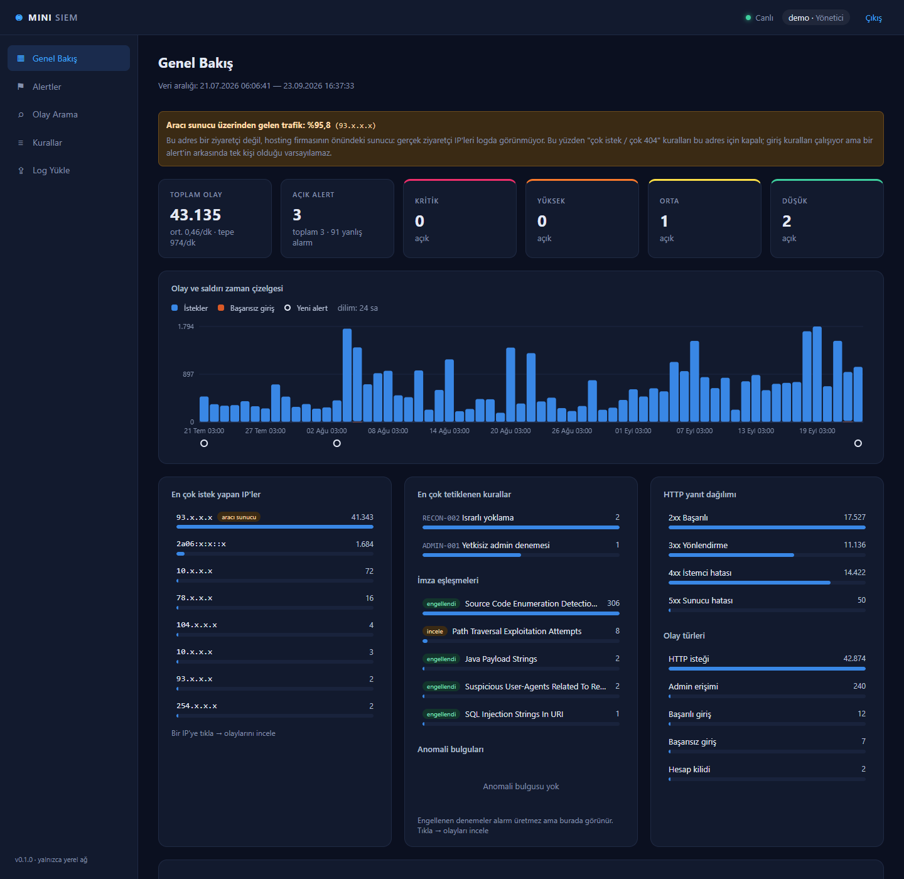
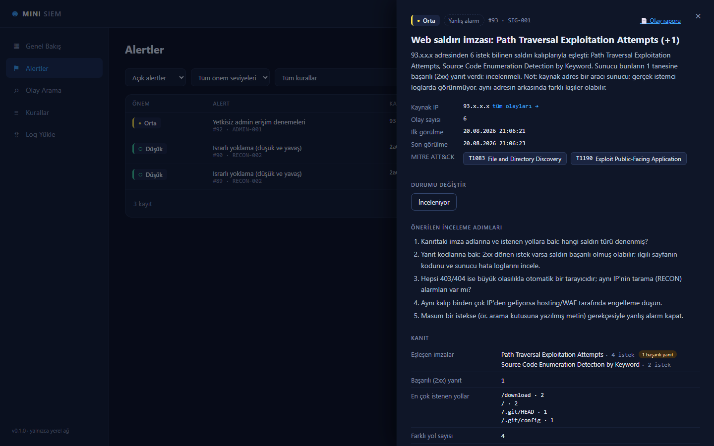
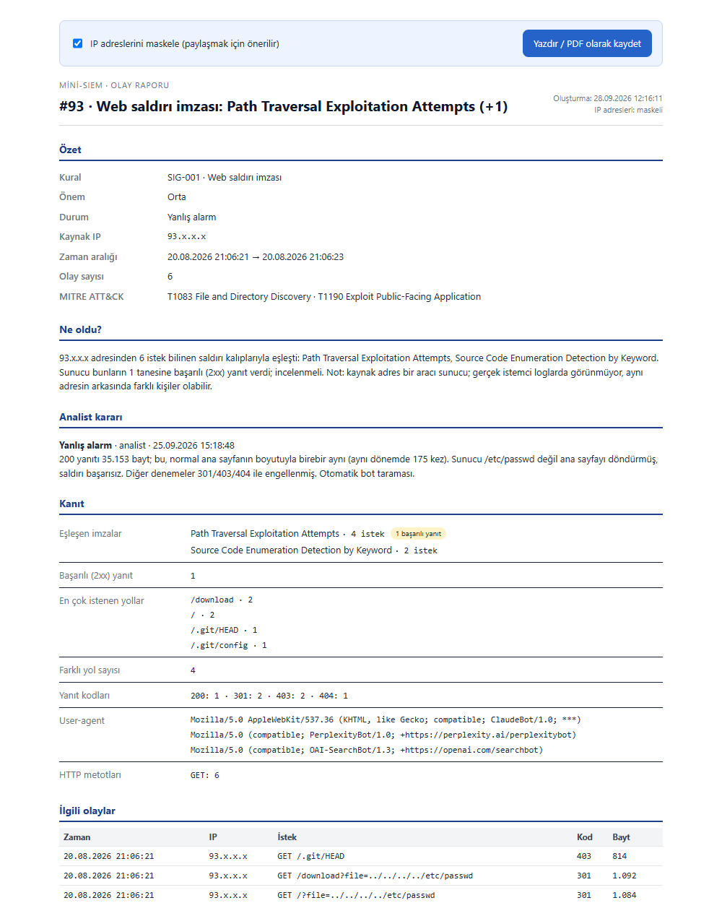
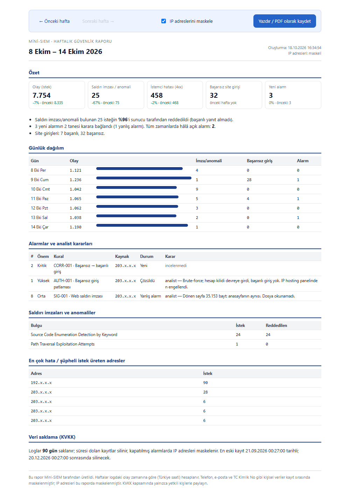
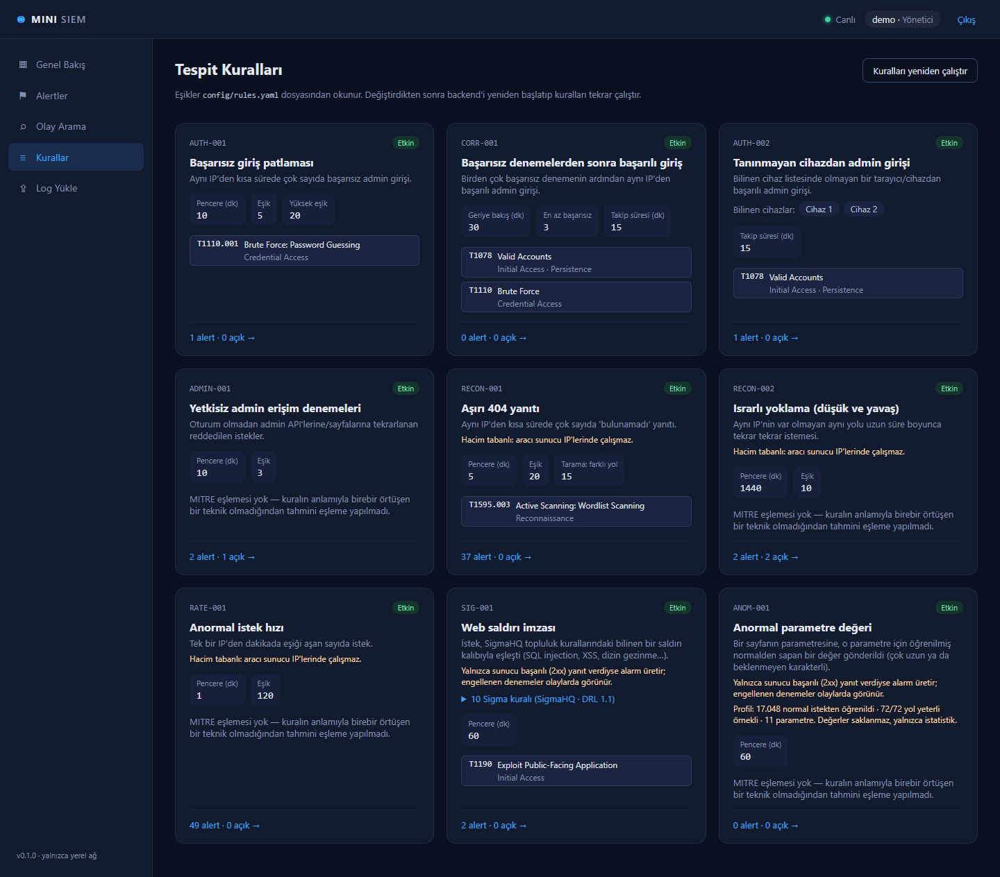
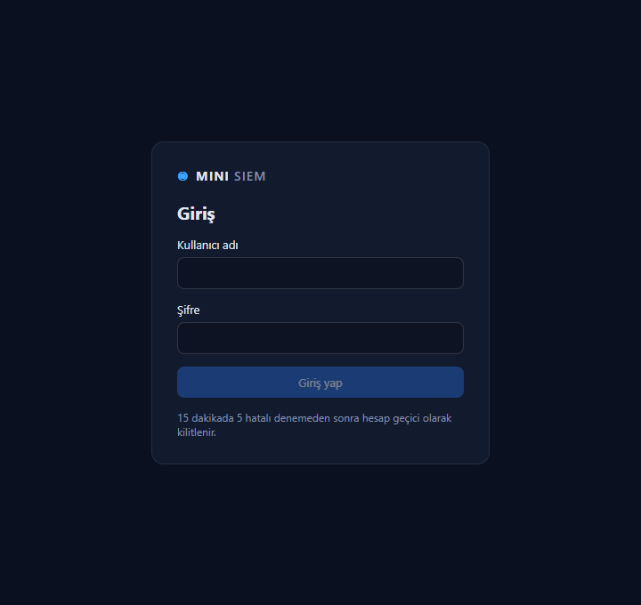

# Mini-SIEM

Gerçek bir kurumsal web sitesinin (bir ortodonti kliniği; PHP, paylaşımlı hosting) sunucu
loglarını toplayan, kişisel verileri maskeleyen, davranış tabanlı kurallarla saldırı tespit eden
ve alarmları bir SOC arayüzünde yöneten, sıfırdan geliştirdiğim eğitim amaçlı bir SIEM.

> **EN:** A small, from-scratch SIEM for a real business website: Apache log ingestion,
> KVKK/GDPR-style PII masking, 7 behavior-based detection rules, 10 SigmaHQ signature rules and a
> learned per-parameter anomaly profile (both evaluated on the raw request before masking; on the
> labeled CSIC 2010 dataset: 37% recall at 99.96% precision, up from 4.2% with signatures alone),
> MITRE ATT&CK mapping, correlation, alert triage workflow, a SOC dashboard, mandatory TOTP
> two-factor login, a 90-day retention policy with secure deletion and a printable weekly report. On 2 months of
> real logs (43,000+ events) it reduced 88 initial alerts to 3 meaningful ones.
> Python · FastAPI · React · TypeScript.



## Gerçek veride öğrendiklerim

İki aylık gerçek sunucu logu (**43.135 olay**) üzerinde çalıştırdığımda:

- **88 alarm → 3 anlamlı alarm.** Trafiğin %95,8'i tek bir IP'den geliyor gibi görünüyordu ve bu
  "tek ziyaretçi" 1.000'den fazla farklı tarayıcı kullanıyordu. Bu IP aslında hosting firmasının
  önündeki **aracı sunucuydu** (proxy): gerçek ziyaretçi IP'si logda yoktu. SIEM'e aracı sunucu
  kavramını ekledim; hacim tabanlı kurallar bu adreste çalışmıyor, giriş kuralları ise alarma
  "aracı sunucu" notu düşüyor.
- **Yavaş saldırılar kısa pencerelere takılmaz.** Bir bot 51 gün boyunca, günde ortalama 13 kez,
  sitede olmayan aynı sayfayı (`/wp-admin/install.php`) aradı. "5 dakikada 20 istek" gibi kurallar
  bunu hiç görmedi; 24 saatlik pencereli yeni bir kural (`RECON-002`) yazdım.
- **Trafiğin ~%28'i gizli dosya arayan botlardı.** `.env` (8.493 istek), `.git`, yedek dosyaları,
  hatta yapay zekâ kodlama araçlarının ayar klasörleri (`.claude`, `.mcp`). Hiçbiri başarılı olmadı.
- **Engellenmiş denemeyi alarma çevirmek gürültüdür.** İmza kuralları 319 isteği bilinen saldırı
  kalıplarıyla eşleştirdi (çoğu `.git` taraması); her eşleşme alarm olsaydı ~91 alarm çıkardı.
  Alarmı yalnızca sunucu başarılı yanıt verdiğinde üretmek bunu 2'ye indirdi; kalan 319 deneme
  kaybolmadı, olay aramasında "imza" olarak görünüyor.
- **Loglar sadece saldırıyı değil, hatayı da anlatır.** Sitedeki bir yükleme hatasının kök nedenini
  sunucu yanıtlarının bayt boyutundan buldum.



## Özellikler

| Katman | Ne yapıyor |
|---|---|
| **Log toplama** | Apache access log yükleme (düz metin veya `.gz`). Boyut sınırı, gzip bombası koruması, ikili dosya reddi, log injection'a karşı güvenli satır bölme. Aynı dosya iki kez yüklenirse çift kayıt oluşmaz |
| **Ayrıştırma** | Apache Combined/Common format, `\"` kaçışları, IPv6; tüm zamanlar UTC'ye çevrilir. Bozuk satırlar sessizce atılmaz, sayılır |
| **Normalizasyon** | Elastic Common Schema'dan (ECS) esinlenen ortak şema. Giriş API'sinin 200/401/429 yanıtlarından *başarılı giriş / başarısız giriş / hesap kilidi* olayları çıkarılır |
| **KVKK** | Kişisel veri formu olan sayfalarda tüm parametreler, hassas parametre adları (tel, email, şifre…), e-posta, telefon ve TC Kimlik No (kontrol haneli doğrulama) maskelenir. **Saklama süresi** (varsayılan 90 gün): eski olaylar silinir, kapatılmış alarmların IP'leri maskelenir |
| **Tespit** | 7 davranış kuralı + 10 SigmaHQ imza kuralı + öğrenilmiş profille anomali tespiti; kayan pencere mantığı, alarm tekilleştirme; eşikler YAML'da |
| **Korelasyon** | Başarısız denemelerin ardından gelen başarılı giriş **kritik** alarm olur; sonraki admin istekleri kanıta eklenir |
| **Alarm yönetimi** | Yeni → İnceleniyor → Doğrulandı / Yanlış alarm → Çözüldü. Gerekçe yazılmadan kapatılamaz, silinmeyen denetim geçmişi tutulur |
| **SOC arayüzü** | Genel bakış, alarm listesi ve detayı, önerilen inceleme adımları, olay arama (threat hunting), kural ekranı, yazdırılabilir olay raporu ve **haftalık özet rapor** |
| **Giriş ve roller** | Herkese zorunlu **iki adımlı doğrulama** (TOTP: Google Authenticator vb. + tek kullanımlık yedek kodlar), scrypt ile saklanan şifreler, HttpOnly + SameSite=Strict oturum çerezi, CSRF başlığı, deneme sınırı; Yönetici / Analist rolleri |
| **MITRE ATT&CK** | Yalnızca kuralın anlamıyla birebir örtüşen teknikler eşlenir; örtüşme yoksa eşleme yapılmaz |

### Tespit kuralları

| Kural | Davranış | Önem | MITRE |
|---|---|---|---|
| `AUTH-001` | 10 dk'da ≥5 başarısız giriş (≥20 veya kilitlenme → yüksek) | Orta/Yüksek | T1110.001 |
| `CORR-001` | ≥3 başarısız denemeden sonra aynı IP'den **başarılı** giriş | **Kritik** | T1110, T1078 |
| `AUTH-002` | Bilinen cihaz listesinde olmayan tarayıcıdan **başarılı** admin girişi | Yüksek | T1078 |
| `ADMIN-001` | 10 dk'da ≥3 reddedilen (401/403) admin isteği | Orta | — |
| `RECON-001` | 5 dk'da ≥20 adet 404; ≥15 farklı yol → tarama | Düşük/Orta | T1595.003 |
| `RECON-002` | Aynı var olmayan yola 24 saatte ≥10 istek, günlerce ("low and slow") | Düşük | — |
| `RATE-001` | Dakikada ≥120 istek | Düşük | — |
| `SIG-001` | İstek, SigmaHQ topluluk kurallarındaki bir saldırı kalıbıyla eşleşti **ve** sunucu 2xx yanıt verdi | Kuraldan | T1190 vb. |
| `ANOM-001` | Parametre değeri öğrenilmiş profilden saptı (çok uzun / beklenmeyen karakter) **ve** sunucu 2xx yanıt verdi | Orta | — |

Elastic'in 10.000 satırlık açık `apache_logs` veri setinde (baseline) imza kuralları **hiç eşleşme
vermedi**. Davranış kurallarından yalnızca `RECON-002` bir alarm üretti: bir yapılandırma aracı
(Chef) silinmiş bir dosyayı 4 gün boyunca 60 kez istemiş. Kötü niyetli değil ama "ısrarlı
yoklama" tanımına uyuyor; analist tek bakışta yanlış alarm olarak kapatır.

### İmza tabanlı tespit (SigmaHQ)

Davranış kuralları "ne kadar, ne sıklıkla" sorar; tek bir istekle yapılan saldırı (ör. SQL
injection) hiçbir eşiği aşmadan geçebilir. Bu yüzden isteğin **içeriğine** de bakılır. Kurallar
kendim uydurduğum listeler değil; güvenlik topluluğunun ortak deposu
[SigmaHQ](https://github.com/SigmaHQ/sigma)'dan değiştirilmeden alınan 10 web sunucusu kuralı
([`config/sigma/`](config/sigma/README.md), lisans: DRL 1.1). Desteklenmeyen bir kural yapısı
görülürse kural yüklenmez; sessizce yanlış çalışmaz.

- **KVKK ile uyum:** kontrol, log yüklenirken **bellekteki ham istek** üzerinde, maskelemeden
  önce yapılır (saldırgan saldırı metnini maskelenen bir alana, ör. `email=`, koyabilir).
  Veritabanına yalnızca eşleşen kuralın adı yazılır; ham istek ve saldırı metni hiçbir yerde
  saklanmaz.
- **Alarm yorgunluğuna karşı:** engellenen (3xx/4xx) denemeler alarm üretmez ama kaybolmaz:
  olaylarda imza olarak görünür, Genel Bakış'ta "engellendi" etiketiyle sayılır. Alarm yalnızca
  sunucu 2xx yanıt verdiyse (saldırı başarılı olmuş olabilir) oluşur (`alert_on: success`).
  Gerçek veride bu ayar ~91 olası alarmı 2'ye indirdi.
- **MITRE:** SigmaHQ'nun SSTI kuralındaki `T1221` (Office belgelerine şablon enjeksiyonu) web
  sunucusuna uymadığı için `T1190` olarak düzeltildi.

**Ölçüm: CSIC 2010 etiketli veri seti** (36.000 normal, 25.065 saldırı isteği):

| | Yakalama (recall) | Kesinlik (precision) | Yanlış alarm oranı |
|---|---|---|---|
| GET istekleri (access log'da görünen) | %4,2 | **%100** | **%0** (28.000 normal istekte 0) |
| Tümü (POST gövdesi dahil) | %2,5 | %100 | %0 |

Yakalama oranı düşük; nedeni ölçüldü:
- Access log POST gövdesini **hiç kaydetmez**; gövdedeki saldırıları hiçbir log tabanlı kural göremez.
- Kaçan GET saldırılarının **%82'si hiçbir özel karakter içermiyor** (geçersiz/çok uzun değer,
  parametre kurcalama). Bunlar SQL injection/XSS değil; imzalar bunun için yazılmaz, bir
  anomali (beklenen değerden sapma) modeli gerekir → [Anomali tespiti](#anomali-tespiti-parametre-kurcalama).
- SigmaHQ kuralları bilerek dar tutulur: **hiç yanlış alarm vermemek**, bir SOC'de her alarmın
  bir analistin zamanı olduğu düşünülünce bilinçli bir tercih.

```powershell
cd backend
.venv\Scripts\python.exe -m app.tools.evaluate_signatures ..\sample_logs\datasets\csic2010  # ölçüm
.venv\Scripts\python.exe -m app.tools.rescan_signatures <log dosyası> --deneme              # eski logları tara
```

### Anomali tespiti (parametre kurcalama)

İmzaların kaçırdığı saldırılar için (`ANOM-001`): sistem sitenin normal trafiğinden her sayfa
ve parametre için bir **profil** öğrenir ("`tarih` hep rakam ve `-`, en fazla 10 karakter")
ve bundan sapan isteği işaretler: **beklenenden uzun** değer ya da **hiç görülmemiş karakter
türü** (rakam beklenen yerde harf veya `'`). Model bilerek basit ve açıklanabilir: analist
"neden?" sorusunun cevabını tek satırda görür.

- **KVKK:** profil yalnızca istatistik tutar (en uzun değer, karakter türü sayaçları); hiçbir
  parametre değeri saklanmaz. Adresinde kişisel veri geçen yollar hiç öğrenilmez, az örnekli
  yollar/parametreler diske yazılmaz (veri minimizasyonu). Profil sitenin yapısını anlattığı
  için yerel dosyadadır ve git'e girmez.
- **"Normal"den öğrenir, saldırıdan değil:** eğitime yalnızca 2xx yanıt alan ve hiçbir imzayla
  eşleşmeyen istekler alınır (3xx de hariç: botlar da http→https yönlendirmesi alır).
- İmzanın zaten yakaladığı istek tekrar alarm üretmez; alarm yalnızca sunucu 2xx döndüyse.

**Ölçüm (CSIC 2010):** profil `normalTrafficTraining` ile öğrenildi, ayrı test dosyalarında
sınandı:

| GET istekleri | Yakalama | Kesinlik | Yanlış alarm |
|---|---|---|---|
| Yalnızca imza | %4,2 | %100 | 0 / 28.000 |
| **İmza + anomali** | **%37,0** | **%99,96** | **2 / 28.000** |

Dürüst notlar:
- Modelde "bilinmeyen parametre adı" bulgusu da var ve açılınca yakalama %60,7'ye çıkıyor.
  Ama incelendiğinde bu artışın CSIC'in saldırıları üretme biçiminden kalan bir izden
  geldiği görüldü (parametre adlarının sonuna "A" eklenmiş: `idA`, `nombreA`); gerçek sitelerde
  ise reklam araçları (`utm_source`, `fbclid`) sürekli yeni parametre ekler. Bu yüzden
  **varsayılan olarak kapalı** ve yukarıdaki sonuçlara dahil değil.
- İki yanlış alarm açıklanabilir nadir değerler: öğrenilenden uzun bir isim, kullanıcı adında `&`.
- Gerçek veride (bu site, 2 ay) anomali bulgusu çıkmadı: sitenin gerçek sayfalarına
  parametre kurcalama denemesi olmamış, saldırılar hep sitede olmayan yollara (`.env`, `.git`)
  yapılmış. Her parametreye 200 dönen statik sayfalar (ana sayfa) botların eklediği
  parametreleri de "normal" öğrenir; bu sayfalarda yöntem zayıftır.

```powershell
cd backend
.venv\Scripts\python.exe -m app.tools.train_profile <log dosyaları>                      # profili öğren
.venv\Scripts\python.exe -m app.tools.evaluate_anomaly ..\sample_logs\datasets\csic2010  # ölçüm
```

### Olay raporu

Alarm detayındaki **📄 Olay raporu** bağlantısı; özet, analist kararı, kanıt, ilgili olaylar ve
denetim kaydıyla yazdırılabilir bir sayfa açar (tarayıcıdan PDF olarak kaydedilir). Rapor
paylaşılmak için üretildiğinden **IP adresleri varsayılan olarak maskelidir** (`93.x.x.x`);
maske kapatılırsa altbilgi bunu açıkça belirtir.



### Haftalık rapor

Menüdeki **Haftalık Rapor**, yöneticiye verilecek bir haftalık özet açar: olay, saldırı imzası,
4xx ve başarısız giriş sayıları (önceki haftaya göre değişimiyle), günlük dağılım, alarmlar ve
analist kararları (aynı kararla kapatılan alarmlar tek satırda), en sık imzalar ve en çok hata
üreten adresler. Haftalar logdaki olay zamanına göre **Türkiye günleriyle** hesaplanır ve
varsayılan hafta son yüklenen logla biter (loglar elle ve gecikmeli yüklendiği için "bugünden
geriye 7 gün" çoğu zaman boş olurdu). Hiç kaydı olmayan günler "log yüklenmemiş olabilir" diye
işaretlenir. Olay raporu gibi IP'ler varsayılan maskelidir; hiçbir veri dışarı gönderilmez
(e-posta yerine yazdırılabilir sayfa: e-posta, SIEM'de bir şifre saklamayı gerektirirdi).



<sub>Bu görüntü gerçek log değil, tanıtım için üretilmiş **sahte demo verisidir** (IP'ler RFC 5737
belge aralıklarından).</sub>

### Veri saklama süresi (KVKK)

Kişisel veri, işleme amacının gerektirdiğinden uzun tutulmaz. SIEM her açılışta
(`baslat.bat`) saklama süresini uygular (`SIEM_RETENTION_DAYS`, varsayılan **90 gün**, en az 7):

- Logdaki zamanı süreyi aşan **olaylar silinir**; SIEM'in kendi giriş kayıtları da.
- **Alarmlar ve analist kararları kalır** (geçmiş ve denetim izi kaybolmaz), ama kapatılmış
  alarmlardaki IP adresleri başlıkta, açıklamada, kanıtta ve analist notunda maskelenir
  (`93.x.x.x`). İncelemesi süren alarma dokunulmaz; kapatılınca maskelenir.
- SQLite silinen satırı dosyada boş sayfa olarak bırakabilir; silme `secure_delete` açıkken
  yapılır ve WAL dosyası boşaltılır. Bir test, silinen kaydın veritabanı **dosyasının
  baytlarında** kalmadığını doğrular.
- Elle çalıştırmak için: `.venv\Scripts\python.exe -m app.tools.retention --deneme`
  (yalnızca sayar). Araç, `data/` klasöründeki elle alınmış yedekleri de listeler: saklama süresi
  yedeklere uygulanmaz, gerekmeyenler elle silinmelidir.



## Kurulum ve çalıştırma

Gereksinimler: Python 3.12, Node.js 20+

```powershell
cd backend
py -3.12 -m venv .venv
.venv\Scripts\python.exe -m pip install -r requirements-dev.txt
.venv\Scripts\python.exe -m uvicorn app.main:app --reload   # API: http://127.0.0.1:8000/docs

cd ..\frontend
npm install
npm run dev                                                 # Arayüz: http://127.0.0.1:5173
```

Windows'ta `baslat.bat` ikisini birden başlatır.

**İlk giriş:** güvenlik gereği varsayılan kullanıcı/şifre **yoktur**. İlk yöneticiyi terminalden
oluştur (şifre ekrana yazılmadan sorulur):

```powershell
cd backend
.venv\Scripts\python.exe -m app.tools.users ekle adin --rol yonetici   # analist için: --rol analist
.venv\Scripts\python.exe -m app.tools.users listele   # diğerleri: sifre <ad> · kilit-ac <ad> · sil <ad>
```

İlk girişte şifreden sonra bir QR kod çıkar: telefondaki doğrulama uygulamasıyla (Google/Microsoft
Authenticator) okutulur ve 10 yedek kod bir kez gösterilir. Sonraki girişlerde şifreden sonra
uygulamadaki 6 haneli kod istenir. Telefon ve yedek kodlar kaybolursa, bilgisayarın başındaki
yönetici terminalden sıfırlar (web arayüzünde bu düğme bilerek yoktur):
`.venv\Scripts\python.exe -m app.tools.users 2fa-sifirla <ad>`



### Kendi siten için ayarlar

Siteye özel bilgiler (admin sayfaları, giriş API'si, bilinen cihazlar, aracı sunucu IP'leri)
koddan ayrıdır ve **git'e girmez**, çünkü bu bilgiler saldırgana harita olur:

| Dosya | İçerik |
|---|---|
| `config/site_profile.example.yaml` → `config/site_profile.local.yaml` | Admin sayfaları, giriş API'si, kişisel veri içeren sayfalar |
| `config/rules.yaml` + `config/rules.local.yaml` | Kural eşikleri + bilinen cihazlar ve aracı sunucu IP'leri |

`.local.yaml` dosyası yoksa örnek profil kullanılır.

## Test ve kalite

```powershell
cd backend
.venv\Scripts\python.exe -m pytest        # 268 test
.venv\Scripts\python.exe -m ruff check .  # lint + bandit güvenlik kuralları

cd ..\frontend
npm run build                             # TypeScript tip kontrolü + derleme
npm run lint
```

Testler gerçek veritabanına ve yerel ayarlara dokunmaz. Test verilerinde yalnızca RFC 5737
dokümantasyon IP'leri ve açıkça sahte kişisel veriler bulunur.

## Güvenlik notları

- Sunucular yalnızca `127.0.0.1` üzerinde çalışır ve internete açılmamalıdır: SIEM, saldırgan için
  en değerli hedeflerden biridir (tüm loglar, admin giriş saatleri, kural eşikleri).
- **Giriş ve oturum:** şifreler scrypt + rastgele tuzla saklanır (en az 12 karakter); oturum
  belirteci HttpOnly + SameSite=Strict çerezde taşınır, veritabanında yalnızca SHA-256 özeti tutulur,
  8 saat sonra düşer. Durum değiştiren her istek `X-Requested-With` başlığı ister (CSRF).
- **İki adımlı doğrulama (herkese zorunlu):** şifre doğruysa yalnızca 5 dakikalık bir *ara oturum*
  açılır; bununla hiçbir veri okunamaz. Telefon kodu doğrulanınca ara oturum silinir ve **yeni** bir
  belirteçle tam oturum açılır (oturum sabitlemeye karşı). Kodlar RFC 6238 (TOTP) ile üretilir,
  aynı kod iki kez kabul edilmez, saat kayması için yalnızca ±30 sn tolerans vardır. Yedek kodlar
  tek kullanımlıktır ve yalnızca özetleri saklanır. Kurulu doğrulama, şifreyle değiştirilemez.
  Bilinen sınır: TOTP anahtarı sunucunun kodu hesaplayabilmesi için veritabanında açık durur
  (standart TOTP'nin doğası); veritabanı yerel diskte kalır ve şifre özetleri olmadan tek başına
  giriş sağlamaz.
- **Brute-force:** 15 dakikada 5 hatalı denemeden (yanlış şifre **veya** yanlış kod) sonra kullanıcı
  adı kilitlenir. Şifreyi bilen biri tekrar tekrar giriş yaparak sayacı sıfırlayamaz; sayaç yalnızca
  iki adım da başarılı olunca sıfırlanır. Var olmayan
  kullanıcı adları da aynı şekilde sayılır ve hata mesajı hep aynıdır: kullanıcı adı yoklanamaz.
  Her giriş denemesi `auth_events` tablosuna yazılır.
- **Roller (en az yetki):** Yönetici log yükler ve kuralları çalıştırır; Analist alarmları
  inceler, kapatır ve rapor alır. Yetki her istekte **sunucuda** kontrol edilir; bir test
  uygulamadaki bütün uçları tarayarak girişsiz erişilebilen uç kalmadığını doğrular.
- Alarm geçmişine değişikliği yapan kişinin kullanıcı adı yazılır (denetim kaydı).
- Log verisi saldırgan verisidir: arayüzde her zaman düz metin olarak gösterilir (log üzerinden XSS'e karşı).
- Tüm veritabanı sorguları parametrelidir; YAML dosyaları `safe_load` ile okunur.
- Gerçek loglar, veritabanı ve siteye özel ayarlar repoda yoktur. Ekran görüntülerindeki IP'ler maskelidir.

## Mimari

```
Apache access log  →  Ayrıştırma  →  KVKK maskeleme  →  SQLite
                                                          │
   SOC arayüzü  ←  Alarm yönetimi  ←  Tespit motoru  ←────┘
```

| Klasör | İçerik |
|---|---|
| `backend/app/ingestion` | Güvenli dosya okuma, işlem hattı |
| `backend/app/parsers` | Apache log parser'ı |
| `backend/app/privacy` | KVKK maskeleme |
| `backend/app/normalization` | Ortak olay şeması, olay sınıflandırma |
| `backend/app/detection` | Tespit motoru ve kurallar |
| `backend/app/alerts` | Alarm durum makinesi |
| `backend/app/api/v1` | REST API |
| `frontend/src` | React + TypeScript SOC arayüzü |
| `config/` | Kural eşikleri, örnek site profili |
| `docs/` | [Mimari ve tasarım kararları](docs/architecture.md) |

**Teknolojiler:** Python · FastAPI · SQLAlchemy · SQLite · Pydantic · Pytest · Ruff ·
React · TypeScript · Vite

## Sonraki adımlar

- IP'nin ülkesini çevrimdışı veritabanıyla gösterme (IP'ler dışarı gönderilmeden)
- Yalnızca maskelenmiş alarm özetleriyle çalışan bir yapay zekâ inceleme asistanı

---

Geliştiren: **Emir Berat Türk** · [LinkedIn](https://www.linkedin.com/in/emirberatturk/)
· Geliştirme sürecinde yapay zekâ kodlama asistanı (Claude Code) kullanıldı.
